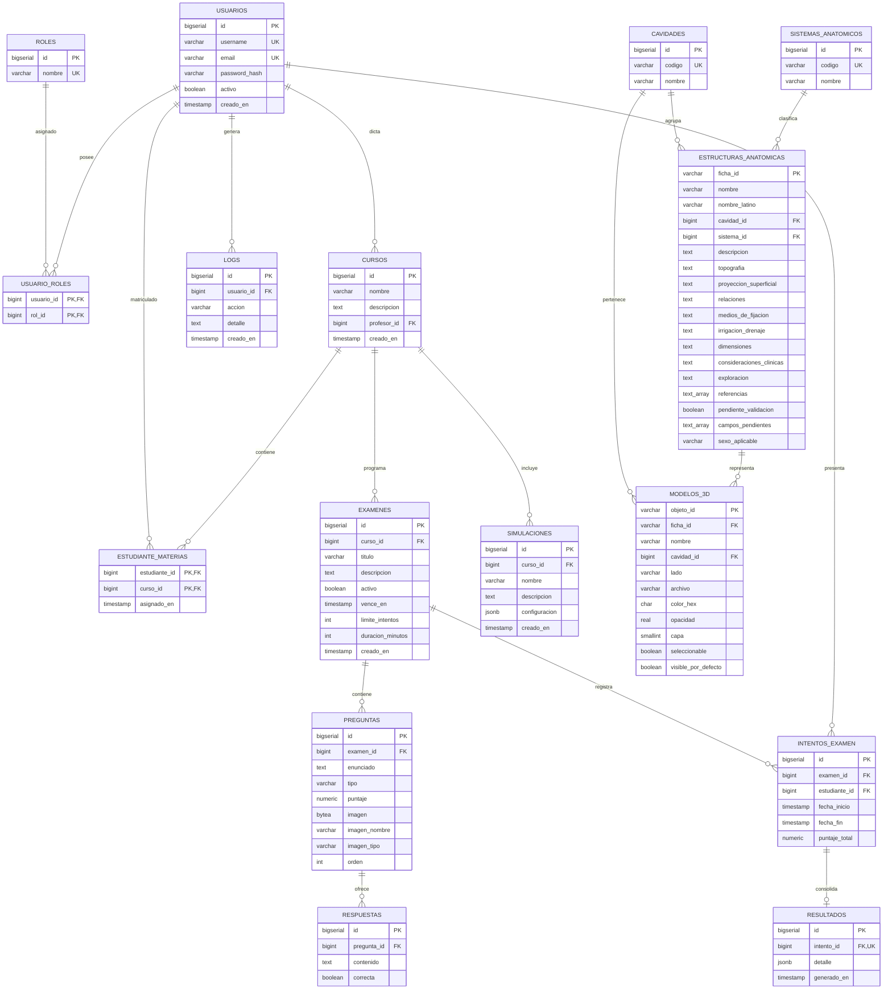

# Manual de Base de Datos y Diccionario de Datos
## Sistema de Gestión Académica y Simulador Anatómico Equino 3D
### Universidad de Pamplona — Facultad de Ciencias Agrarias

---

## 1. Visión General del Modelo Relacional

La persistencia del sistema está soportada en el motor relacional **PostgreSQL** (versiones 14 a 18). El modelo está diseñado siguiendo estrictamente los principios de la **Tercera Forma Normal (3FN)**, eliminando redundancias, asegurando dependencias funcionales directas respecto a las claves primarias y aplicando integridad referencial mediante claves foráneas con políticas de eliminación consistentes (`ON DELETE CASCADE`, `ON DELETE RESTRICT` o `ON DELETE SET NULL`).

El esquema se divide en dos dominios complementarios:
1. **Dominio Académico y LMS**: Gestión de usuarios, autenticación, control de acceso basado en roles, cursos, matrículas, exámenes, banco de preguntas con imágenes, intentos y auditoría.
2. **Dominio Anatómico 3D**: Catálogo de cavidades, sistemas corporales, estructuras anatómicas normalizadas (según la *Nomina Anatomica Veterinaria*) y metadatos de los modelos tridimensionales interactivos.

---

## 2. Diagrama Entidad-Relación (ER)



---

## 3. Diccionario de Datos Detallado

### 3.1 Dominio Académico y LMS

#### Tabla: `roles`
Almacena los roles de seguridad predefinidos en la plataforma.
- **Archivo SQL**: [`db/schema.sql`](../db/schema.sql)

| Columna | Tipo de Dato | Nulo | Clave / Restricción | Valor por Defecto | Descripción |
| :--- | :--- | :---: | :--- | :--- | :--- |
| `id` | `BIGSERIAL` | No | **PK** | Secuencia auto | Identificador secuencial único del rol. |
| `nombre` | `VARCHAR(50)` | No | **UNIQUE** | — | Nombre del rol (`ADMINISTRADOR`, `PROFESOR`, `ESTUDIANTE`). |

---

#### Tabla: `usuarios`
Entidad principal de usuarios del sistema con credenciales cifradas y estado operativo.
- **Archivo SQL**: [`db/schema.sql`](../db/schema.sql)

| Columna | Tipo de Dato | Nulo | Clave / Restricción | Valor por Defecto | Descripción |
| :--- | :--- | :---: | :--- | :--- | :--- |
| `id` | `BIGSERIAL` | No | **PK** | Secuencia auto | Identificador único del usuario. |
| `username` | `VARCHAR(50)` | No | **UNIQUE** | — | Nombre de usuario para autenticación en la plataforma. |
| `email` | `VARCHAR(120)` | No | **UNIQUE** | — | Correo electrónico institucional. |
| `password_hash` | `VARCHAR(200)` | No | — | — | Hash de contraseña generado con algoritmo BCrypt. |
| `activo` | `BOOLEAN` | No | — | `TRUE` | Bandera de estado: permite suspender o habilitar el acceso. |
| `creado_en` | `TIMESTAMP` | No | — | `CURRENT_TIMESTAMP` | Fecha y hora de registro del usuario. |

---

#### Tabla: `usuario_roles`
Tabla intermedia para la relación muchos a muchos ($N:M$) entre usuarios y roles.
- **Archivo SQL**: [`db/schema.sql`](../db/schema.sql)

| Columna | Tipo de Dato | Nulo | Clave / Restricción | Valor por Defecto | Descripción |
| :--- | :--- | :---: | :--- | :--- | :--- |
| `usuario_id` | `BIGINT` | No | **PK, FK** `usuarios(id)` ON DELETE CASCADE | — | ID del usuario vinculado. |
| `rol_id` | `BIGINT` | No | **PK, FK** `roles(id)` ON DELETE RESTRICT | — | ID del rol asignado. |

---

#### Tabla: `cursos`
Asignaturas académicas registradas en el sistema vinculadas a un docente titular.
- **Archivo SQL**: [`db/schema.sql`](../db/schema.sql)

| Columna | Tipo de Dato | Nulo | Clave / Restricción | Valor por Defecto | Descripción |
| :--- | :--- | :---: | :--- | :--- | :--- |
| `id` | `BIGSERIAL` | No | **PK** | Secuencia auto | Identificador único del curso o asignatura. |
| `nombre` | `VARCHAR(120)` | No | — | — | Nombre de la asignatura (ej. *Anatomía Veterinaria I*). |
| `descripcion` | `TEXT` | Sí | — | — | Descripción pedagógica o sinopsis del curso. |
| `profesor_id` | `BIGINT` | No | **FK** `usuarios(id)` ON DELETE RESTRICT | — | ID del docente o administrador titular responsable. |
| `creado_en` | `TIMESTAMP` | No | — | `CURRENT_TIMESTAMP` | Fecha y hora de creación de la materia. |

- **Índices**: `idx_cursos_profesor` sobre `profesor_id`.

---

#### Tabla: `estudiante_materias`
Relación muchos a muchos ($N:M$) que formaliza la matrícula de un estudiante en un curso.
- **Archivo SQL**: [`db/schema.sql`](../db/schema.sql)

| Columna | Tipo de Dato | Nulo | Clave / Restricción | Valor por Defecto | Descripción |
| :--- | :--- | :---: | :--- | :--- | :--- |
| `estudiante_id` | `BIGINT` | No | **PK, FK** `usuarios(id)` ON DELETE CASCADE | — | ID del estudiante matriculado. |
| `curso_id` | `BIGINT` | No | **PK, FK** `cursos(id)` ON DELETE CASCADE | — | ID del curso al que se asocia el alumno. |
| `asignado_en` | `TIMESTAMP` | No | — | `CURRENT_TIMESTAMP` | Fecha y hora de la matrícula. |

- **Índices**: `idx_estudiante_materias_estudiante`, `idx_estudiante_materias_curso`.

---

#### Tabla: `examenes`
Evaluaciones programadas asociadas a una materia con control de intentos y tiempo de resolución.
- **Archivo SQL**: [`db/schema.sql`](../db/schema.sql)

| Columna | Tipo de Dato | Nulo | Clave / Restricción | Valor por Defecto | Descripción |
| :--- | :--- | :---: | :--- | :--- | :--- |
| `id` | `BIGSERIAL` | No | **PK** | Secuencia auto | Identificador único del examen. |
| `curso_id` | `BIGINT` | No | **FK** `cursos(id)` ON DELETE CASCADE | — | Curso al que pertenece la evaluación. |
| `titulo` | `VARCHAR(120)` | No | — | — | Título visible de la prueba diagnóstica. |
| `descripcion` | `TEXT` | Sí | — | — | Indicaciones y pautas pedagógicas del examen. |
| `activo` | `BOOLEAN` | No | — | `TRUE` | Habilitación administrativa de la prueba. |
| `vence_en` | `TIMESTAMP` | Sí | — | — | Fecha y hora límite para la presentación. |
| `limite_intentos`| `INT` | No | — | `1` | Máximo número de oportunidades permitidas por estudiante. |
| `duracion_minutos`| `INT` | No | — | `60` | Tiempo límite en minutos cronometrado en la ventana. |
| `creado_en` | `TIMESTAMP` | No | — | `CURRENT_TIMESTAMP` | Fecha y hora de creación de la evaluación. |

- **Índices**: `idx_examenes_curso`, `idx_examenes_activo`, `idx_examenes_vence_en`.

---

#### Tabla: `preguntas`
Reactivos y preguntas evaluativas con soporte multimedia para imágenes médicas.
- **Archivo SQL**: [`db/schema.sql`](../db/schema.sql)

| Columna | Tipo de Dato | Nulo | Clave / Restricción | Valor por Defecto | Descripción |
| :--- | :--- | :---: | :--- | :--- | :--- |
| `id` | `BIGSERIAL` | No | **PK** | Secuencia auto | Identificador único de la pregunta. |
| `examen_id` | `BIGINT` | No | **FK** `examenes(id)` ON DELETE CASCADE | — | Examen al que pertenece el reactivo. |
| `enunciado` | `TEXT` | No | — | — | Texto o formulación de la pregunta. |
| `tipo` | `VARCHAR(30)` | No | — | — | Tipo de pregunta (`MULTIPLE_CHOICE`, `SINGLE_CHOICE`, etc.). |
| `puntaje` | `NUMERIC(6,2)` | No | — | `1.00` | Valor ponderado de la pregunta en la nota total. |
| `imagen` | `BYTEA` | Sí | — | — | Bytes binarios de la imagen diagnóstica adjunta. |
| `imagen_nombre`| `VARCHAR(255)`| Sí | — | — | Nombre original del archivo de imagen. |
| `imagen_tipo` | `VARCHAR(100)`| Sí | — | — | Tipo MIME de la imagen (ej. `image/png`, `image/jpeg`). |
| `orden` | `INT` | No | — | `0` | Secuencia numérica de ordenamiento predeterminado. |

- **Índices**: `idx_preguntas_examen`.

---

#### Tabla: `respuestas`
Opciones de respuesta disponibles para cada pregunta del examen.
- **Archivo SQL**: [`db/schema.sql`](../db/schema.sql)

| Columna | Tipo de Dato | Nulo | Clave / Restricción | Valor por Defecto | Descripción |
| :--- | :--- | :---: | :--- | :--- | :--- |
| `id` | `BIGSERIAL` | No | **PK** | Secuencia auto | Identificador único de la opción. |
| `pregunta_id` | `BIGINT` | No | **FK** `preguntas(id)` ON DELETE CASCADE | — | Pregunta a la que corresponde la opción. |
| `contenido` | `TEXT` | No | — | — | Texto de la alternativa o respuesta. |
| `correcta` | `BOOLEAN` | No | — | `FALSE` | `TRUE` si la opción otorga el puntaje de acierto. |

- **Índices**: `idx_respuestas_pregunta`.

---

#### Tabla: `intentos_examen`
Registro de cada sesión de examen presentada por un alumno.
- **Archivo SQL**: [`db/schema.sql`](../db/schema.sql)

| Columna | Tipo de Dato | Nulo | Clave / Restricción | Valor por Defecto | Descripción |
| :--- | :--- | :---: | :--- | :--- | :--- |
| `id` | `BIGSERIAL` | No | **PK** | Secuencia auto | Identificador único del intento. |
| `examen_id` | `BIGINT` | No | **FK** `examenes(id)` ON DELETE CASCADE | — | Examen presentado. |
| `estudiante_id`| `BIGINT` | No | **FK** `usuarios(id)` ON DELETE RESTRICT | — | Estudiante que realizó la prueba. |
| `fecha_inicio` | `TIMESTAMP` | No | — | `CURRENT_TIMESTAMP` | Marca temporal de inicio de la prueba. |
| `fecha_fin` | `TIMESTAMP` | Sí | — | — | Marca temporal de finalización o cierre forzado. |
| `puntaje_total`| `NUMERIC(6,2)`| Sí | — | — | Calificación final consolidada (escala 0.00 a 5.00). |

- **Índices**: `idx_intentos_examen_examen`, `idx_intentos_examen_estudiante`.

---

#### Tabla: `resultados`
Detalle estructurado de las respuestas enviadas en un intento para auditoría y retroalimentación.
- **Archivo SQL**: [`db/schema.sql`](../db/schema.sql)

| Columna | Tipo de Dato | Nulo | Clave / Restricción | Valor por Defecto | Descripción |
| :--- | :--- | :---: | :--- | :--- | :--- |
| `id` | `BIGSERIAL` | No | **PK** | Secuencia auto | Identificador del resultado. |
| `intento_id` | `BIGINT` | No | **FK, UNIQUE** `intentos_examen(id)` ON DELETE CASCADE | — | Intento al que pertenece el desglose. |
| `detalle` | `JSONB` | Sí | — | — | Documento JSON con respuestas seleccionadas y retroalimentación. |
| `generado_en` | `TIMESTAMP` | No | — | `CURRENT_TIMESTAMP` | Fecha de generación del resultado. |

- **Índices**: `idx_resultados_intento`.

---

#### Tabla: `simulaciones`
Prácticas pedagógicas tridimensionales asignadas a una asignatura.
- **Archivo SQL**: [`db/schema.sql`](../db/schema.sql)

| Columna | Tipo de Dato | Nulo | Clave / Restricción | Valor por Defecto | Descripción |
| :--- | :--- | :---: | :--- | :--- | :--- |
| `id` | `BIGSERIAL` | No | **PK** | Secuencia auto | Identificador único de la práctica virtual. |
| `curso_id` | `BIGINT` | No | **FK** `cursos(id)` ON DELETE CASCADE | — | Materia que contiene la práctica. |
| `nombre` | `VARCHAR(120)` | No | — | — | Nombre asignado a la práctica anatómica. |
| `descripcion` | `TEXT` | Sí | — | — | Descripción de las actividades a realizar. |
| `configuracion`| `JSONB` | Sí | — | — | Parámetros del visor 3D, objetivos y escenarios. |
| `creado_en` | `TIMESTAMP` | No | — | `CURRENT_TIMESTAMP` | Fecha de creación de la práctica. |

- **Índices**: `idx_simulaciones_curso`.

---

#### Tabla: `logs`
Bitácora de auditoría inmutable de todas las acciones operativas del sistema.
- **Archivo SQL**: [`db/schema.sql`](../db/schema.sql)

| Columna | Tipo de Dato | Nulo | Clave / Restricción | Valor por Defecto | Descripción |
| :--- | :--- | :---: | :--- | :--- | :--- |
| `id` | `BIGSERIAL` | No | **PK** | Secuencia auto | Identificador único del registro de auditoría. |
| `usuario_id` | `BIGINT` | Sí | **FK** `usuarios(id)` ON DELETE SET NULL | — | Usuario responsable (nulo si fue acción del sistema). |
| `accion` | `VARCHAR(120)` | No | — | — | Código de la acción (`LOGIN`, `SIM_3D_SESION`, `BACKUP`, etc.). |
| `detalle` | `TEXT` | Sí | — | — | Información contextual, parámetros o métricas de la acción. |
| `creado_en` | `TIMESTAMP` | No | — | `CURRENT_TIMESTAMP` | Marca temporal exacta del evento. |

- **Índices**: `idx_logs_usuario`, `idx_logs_creado_en`.

---

### 3.2 Dominio Anatómico y Modelos 3D

#### Tabla: `cavidades`
Catálogo de las regiones y cavidades orgánicas del equino.
- **Archivo SQL**: [`db/cavidades_schema.sql`](../db/cavidades_schema.sql)

| Columna | Tipo de Dato | Nulo | Clave / Restricción | Valor por Defecto | Descripción |
| :--- | :--- | :---: | :--- | :--- | :--- |
| `id` | `BIGSERIAL` | No | **PK** | Secuencia auto | Identificador numérico de la cavidad. |
| `codigo` | `VARCHAR(30)` | No | **UNIQUE** | — | Código corto (`toracica`, `abdominal`, `inguinal`). |
| `nombre` | `VARCHAR(120)` | No | — | — | Nombre formal de la cavidad anatómica. |

---

#### Tabla: `sistemas_anatomicos`
Catálogo de los sistemas biológicos a los que pertenecen los órganos.
- **Archivo SQL**: [`db/cavidades_schema.sql`](../db/cavidades_schema.sql)

| Columna | Tipo de Dato | Nulo | Clave / Restricción | Valor por Defecto | Descripción |
| :--- | :--- | :---: | :--- | :--- | :--- |
| `id` | `BIGSERIAL` | No | **PK** | Secuencia auto | Identificador único del sistema corporal. |
| `codigo` | `VARCHAR(30)` | No | **UNIQUE** | — | Código del sistema (`digestivo`, `circulatorio`, etc.). |
| `nombre` | `VARCHAR(120)` | No | — | — | Nombre formal del sistema anatómico. |

---

#### Tabla: `estructuras_anatomicas`
Fichas anatómicas exhaustivas validadas según la *Nomina Anatomica Veterinaria* (NAV).
- **Archivo SQL**: [`db/cavidades_schema.sql`](../db/cavidades_schema.sql)

| Columna | Tipo de Dato | Nulo | Clave / Restricción | Valor por Defecto | Descripción |
| :--- | :--- | :---: | :--- | :--- | :--- |
| `ficha_id` | `VARCHAR(60)` | No | **PK** | — | Identificador alfanumérico estable de la ficha (ej. `TOR_CORAZON`). |
| `nombre` | `VARCHAR(160)` | No | — | — | Nombre vulgar u oficial en idioma español. |
| `nombre_latino` | `VARCHAR(200)` | Sí | — | — | Término latino oficial estandarizado en la NAV. |
| `cavidad_id` | `BIGINT` | No | **FK** `cavidades(id)` ON DELETE RESTRICT | — | Cavidad donde se aloja la estructura. |
| `sistema_id` | `BIGINT` | No | **FK** `sistemas_anatomicos(id)` ON DELETE RESTRICT | — | Sistema funcional al que pertenece el órgano. |
| `descripcion` | `TEXT` | No | — | — | Descripción morfofuncional detallada. |
| `topografia` | `TEXT` | Sí | — | — | Ubicación espacial y límites en el cuerpo equino. |
| `proyeccion_superficial`| `TEXT`| Sí | — | — | Proyección sobre la superficie cutánea y costillas. |
| `relaciones` | `TEXT` | Sí | — | — | Órganos vecinos en contacto anatómico directo. |
| `medios_de_fijacion`| `TEXT` | Sí | — | — | Ligamentos, mesos, pliegues serosos y fascia. |
| `irrigacion_drenaje`| `TEXT` | Sí | — | — | Aporte arterial, retorno venoso y drenaje linfático. |
| `dimensiones` | `TEXT` | Sí | — | — | Medidas biométricas (longitud, peso, volumen promedio). |
| `consideraciones_clinicas`| `TEXT`| Sí | — | — | Implicaciones en patología veterinaria y cirugía. |
| `exploracion` | `TEXT` | Sí | — | — | Métodos de examen semiológico (auscultación, palpación). |
| `referencias` | `TEXT[]` | Sí | — | — | Arreglo de fuentes bibliográficas consultadas. |
| `pendiente_validacion`| `BOOLEAN`| No | — | `TRUE` | Indica si los datos biométricos requieren cotejo final. |
| `campos_pendientes`| `TEXT[]` | Sí | — | — | Lista de campos específicos pendientes de verificación. |
| `sexo_aplicable`| `VARCHAR(10)` | No | `CHECK IN ('ambos','macho','hembra')`| `'ambos'` | Aplicabilidad morfológica según el sexo del animal. |

- **Índices**: `idx_estructuras_cavidad`, `idx_estructuras_sistema`.

---

#### Tabla: `modelos_3d`
Metadatos de cada malla tridimensional de los órganos en el visor VTK.
- **Archivo SQL**: [`db/cavidades_schema.sql`](../db/cavidades_schema.sql)

| Columna | Tipo de Dato | Nulo | Clave / Restricción | Valor por Defecto | Descripción |
| :--- | :--- | :---: | :--- | :--- | :--- |
| `objeto_id` | `VARCHAR(60)` | No | **PK** | — | Identificador del nodo en Blender y escena GLB. |
| `ficha_id` | `VARCHAR(60)` | Sí | **FK** `estructuras_anatomicas(ficha_id)` ON DELETE CASCADE | — | Ficha anatómica asociada (nulo para referencias). |
| `nombre` | `VARCHAR(160)` | No | — | — | Nombre visual descriptivo del objeto 3D. |
| `cavidad_id` | `BIGINT` | No | **FK** `cavidades(id)` ON DELETE RESTRICT | — | Cavidad a la que pertenece el objeto. |
| `lado` | `VARCHAR(3)` | No | `CHECK IN ('IZQ', 'DER', 'MED')` | — | Lateralidad anatómica de la estructura. |
| `archivo` | `VARCHAR(255)` | No | — | — | Ruta relativa al archivo de malla (.OBJ). |
| `color_hex` | `CHAR(7)` | No | — | — | Color base asignado en formato hexadecimal (`#RRGGBB`). |
| `opacidad` | `REAL` | No | `CHECK (opacidad > 0 AND opacidad <= 1)` | — | Nivel de transparencia de la malla en VTK. |
| `capa` | `SMALLINT` | No | `CHECK (capa BETWEEN 0 AND 3)` | — | Nivel de profundidad anatómica para el despiece. |
| `seleccionable` | `BOOLEAN` | No | — | — | Determina si el objeto responde a clics del usuario. |
| `visible_por_defecto`| `BOOLEAN`| No | — | `TRUE` | Visibilidad inicial al cargar el modelo. |

- **Índices**: `idx_modelos_3d_ficha`.

---

## 4. Especificación Técnica de Columnas JSONB

### 4.1 Columna `simulaciones.configuracion`
Configura los parámetros pedagógicos y el entorno de visualización para una práctica:

```json
{
  "modelo_script": "cavidad_toracica.py",
  "titulo": "Exploración de la Cavidad Torácica",
  "descripcion": "Identificación de vísceras torácicas y relaciones del corazón.",
  "objetivo": "Reconocer pulmones y corazón junto con grandes vasos y diafragma.",
  "instrucciones": [
    "Utiliza la rueda del ratón para acercarte y activar el despiece de los pulmones.",
    "Haz clic sobre el corazón y revisa sus focos de auscultación en la ficha clínica."
  ],
  "escenario": {
    "titulo": "Paciente con sospecha de pleuroneumonía",
    "descripcion": "Evalúa el receso costodiafragmático y las líneas de proyección pulmonar."
  }
}
```

### 4.2 Columna `resultados.detalle`
Guarda el estado completo y las respuestas emitidas durante una sesión de evaluación:

```json
{
  "intento_id": 42,
  "estudiante_id": 15,
  "total_preguntas": 10,
  "aciertos": 8,
  "puntaje_obtenido": 4.0,
  "respuestas": [
    {
      "pregunta_id": 101,
      "enunciado": "¿Qué estructura separa las cavidades torácica y abdominal?",
      "tipo": "SINGLE_CHOICE",
      "puntaje_asignado": 1.0,
      "opciones_seleccionadas": [402],
      "opciones_correctas": [402],
      "es_correcta": true,
      "retroalimentacion": "Respuesta correcta: El diafragma es el músculo delimitador principal."
    }
  ]
}
```

---

## 5. Procedimientos de Respaldo y Restauración

El sistema provee automatización de copias de seguridad mediante la clase [`DatabaseBackupService.java`](../src/app/service/DatabaseBackupService.java), la cual interactúa directamente con las utilidades de línea de comandos de PostgreSQL:

- **Generación de Respaldo (`pg_dump`)**:
  - Comando ejecutado: `pg_dump.exe -h localhost -p <puerto> -U postgres -F c -b -v -f <archivo.dump> <bd>`
  - Formato: Binario personalizado comprimido (`-F c`), compatible con restauración transaccional completa.
  - Almacenamiento: `%LOCALAPPDATA%\GestionAcademica\backups\` con sellos de tiempo automáticos (`backup_gestion_YYYYMMDD_HHMMSS.dump`).
- **Restauración de Respaldo (`pg_restore`)**:
  - Comando ejecutado: `pg_restore.exe -h localhost -p <puerto> -U postgres -d <bd> -c --if-exists <archivo.dump>`
  - Limpieza preventiva de tablas con `-c` (*clean*) para evitar inconsistencias de claves foráneas.
