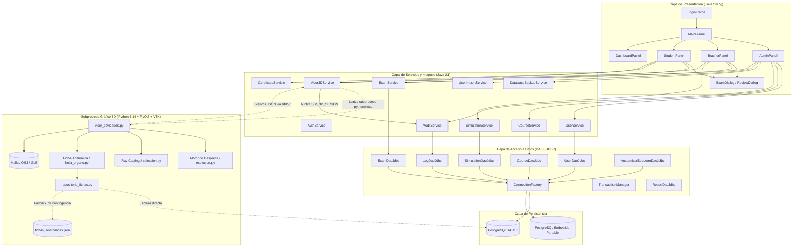
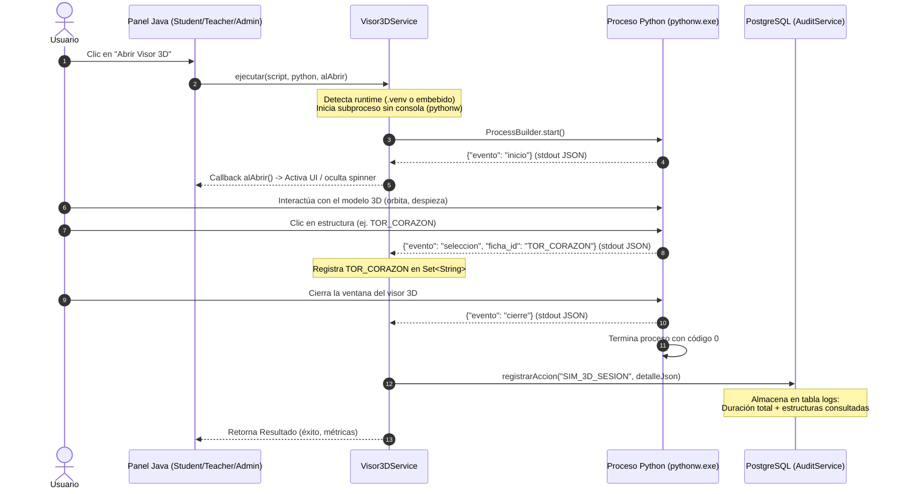

# Manual Técnico y de Arquitectura de Software
## Sistema de Gestión Académica y Simulador Anatómico Equino 3D
### Universidad de Pamplona — Facultad de Ciencias Agrarias

---

## 1. Ficha Técnica del Proyecto

| Parámetro | Detalle |
| :--- | :--- |
| **Nombre del Sistema** | Sistema de Gestión Académica y Simulador Anatómico Equino 3D |
| **Institución** | Universidad de Pamplona (Pamplona, Norte de Santander, Colombia) |
| **Área de Aplicación** | Medicina Veterinaria, Zootecnia y Ciencias Básicas Anatómicas |
| **Lenguaje Principal** | Java 21 LTS / Java 26 (Capa Core y Presentación Desktop) |
| **Lenguaje Secundario** | Python 3.9+ / 3.14 (Motor Gráfico 3D y Modelado Matemático) |
| **Librería Gráfica GUI** | Java Swing con arquitectura moderna de temas (`UiTheme`) |
| **Motor Gráfico 3D** | VTK 9.x (Visualization Toolkit) integrado sobre PyQt5 |
| **Modelado Paramétrico** | Blender 4.2 LTS (generación por scripts deterministas) |
| **Motor de Base de Datos** | PostgreSQL 14+ / PostgreSQL 18 (modo embebido o externo) |
| **Control de Acceso** | RBAC (Role-Based Access Control) con auditoría transaccional |
| **Seguridad Criptográfica** | jBCrypt 0.4 (Blowfish hashing con salt aleatorio) y SHA-256 |
| **Framework de Pruebas** | JUnit 5 Standalone 1.10.1 (Java) y Pytest (Python) |
| **Empaquetado y Distribución** | `jpackage` con WiX Toolset 3.14 (Instalador MSI/EXE todo-en-uno) |

---

## 2. Visión General de la Arquitectura

El sistema implementa una arquitectura híbrida desacoplada, donde la gestión académica, la persistencia de datos y el flujo evaluativo se ejecutan en un núcleo de alto rendimiento en **Java**, mientras que la visualización tridimensional, el despiece espacial y el cálculo topológico se delegan a visores interactivos en **Python + VTK**, orquestados de manera reactiva mediante comunicación entre procesos (**IPC**).



---

## 3. Patrones de Diseño de Software Implementados

La solución adopta principios de la ingeniería de software como SOLID, separación estricta de responsabilidades (SoC) y alta cohesión con bajo acoplamiento mediante los siguientes patrones:

### 3.1 Data Access Object (DAO)
Todas las operaciones de lectura, escritura y actualización sobre el motor de base de datos se encapsulan detrás de interfaces tipadas ubicadas en el paquete [`app.dao`](../src/app/dao):
- **Interfaces**: `UserDao`, `CourseDao`, `ExamDao`, `QuestionDao`, `AnswerDao`, `ExamAttemptDao`, `ResultDao`, `SimulationDao`, `LogDao`, `AnatomicalStructureDao`.
- **Implementaciones**: [`app.dao.jdbc`](../src/app/dao/jdbc) con consultas SQL puras y parametrizadas mediante `PreparedStatement`, garantizando total protección frente a ataques de inyección SQL (SQLi).

### 3.2 Service Layer (Capa de Servicios)
Desacopla la lógica de negocio y las validaciones de la capa de interfaz de usuario:
- Las transacciones de negocio complejas (p. ej., calificación de un examen, cálculo de intentos restantes, emisión de certificados con hash) se resuelven íntegramente en los servicios del paquete [`app.service`](../src/app/service).
- Las vistas Swing únicamente invocan métodos del servicio y gestionan el estado visual.

### 3.3 Session Management & Singleton State
La sesión del usuario conectado se mantiene en [`SessionManager`](../src/app/session/SessionManager.java) mediante una instancia inmutable de [`Session`](../src/app/session/Session.java), la cual transporta:
- Objeto [`User`](../src/app/model/User.java) autenticado.
- Conjunto de roles vigentes ([`RoleType`](../src/app/model/RoleType.java): `ADMINISTRADOR`, `PROFESOR`, `ESTUDIANTE`).
- Marca temporal de autenticación y métodos de validación de permisos en tiempo de ejecución (`hasRole()`, `isAdmin()`).

### 3.4 Factory Method y Connection Pooling
- [`ConnectionFactory`](../src/app/db/ConnectionFactory.java): Administra la creación de conexiones JDBC, la configuración de timeouts y la detección de fallos de red.
- [`TransactionManager`](../src/app/db/TransactionManager.java): Permite ejecutar bloques funcionales de código dentro de una transacción JDBC con `setAutoCommit(false)`, `commit()` preventivo y `rollback()` automático en caso de excepción `SQLException`.

### 3.5 Model-View Separation y Component-Based GUI
- La interfaz de usuario Swing está estandarizada mediante la clase de diseño [`UiTheme`](../src/app/ui/UiTheme.java), que define una paleta cromática profesional basada en tokens (colores institucionales, tipografías escalables, bordes redondeados y renderizado antialiasing).
- Los diálogos modales complejas (edición por lotes, previsualización de cuestionarios, visor de intentos) heredan de componentes base como [`FormModal`](../src/app/ui/FormModal.java).

### 3.6 Inter-Process Communication (IPC) Streaming
La interoperabilidad entre la máquina virtual de Java (JVM) y el runtime de Python se realiza mediante subprocesos reactivos sin bloqueo:
- Java lanza el visor usando `pythonw.exe` mediante `ProcessBuilder`.
- Python emite una línea JSON por `stdout` en momentos clave: inicio de la ventana, selección de una pieza anatómica y cierre del visor.
- Un hilo secundario en Java (`CompletableFuture` / `Thread`) decodifica las líneas en streaming, registra las estructuras exploradas y al terminar guarda la auditoría de la sesión en PostgreSQL.

---

## 4. Desglose de Módulos y Paquetes de Java

### 4.1 Paquete `app.config`
- [`AppConfig.java`](../src/app/config/AppConfig.java): Encargado de leer el archivo `config/app.properties`. Soporta dos modos operativos:
  1. **Modo Externo**: Conexión a un servidor PostgreSQL centralizado mediante `db.url`, `db.user` y `db.password`.
  2. **Modo Embebido (`app.db.embedded=true`)**: Indica a la aplicación que debe arrancar y gestionar un motor local PostgreSQL portable incluido en el instalador.

### 4.2 Paquete `app.db`
- [`ConnectionFactory.java`](../src/app/db/ConnectionFactory.java): Fuente central de conexiones `java.sql.Connection`.
- [`TransactionManager.java`](../src/app/db/TransactionManager.java): Facilitador de transacciones atómicas.
- [`EmbeddedDatabase.java`](../src/app/db/EmbeddedDatabase.java): Controlador integral del motor PostgreSQL local portable.
  - Verifica si el cluster ya existe en `%LOCALAPPDATA%\GestionAcademica\basedatos`. Si no existe, ejecuta `initdb.exe` con codificación UTF-8.
  - Genera una contraseña segura y aleatoria para el superusuario `postgres`.
  - Busca un puerto TCP libre (iniciando en 15432) para evitar colisiones con servicios locales existentes.
  - Inicia el servidor mediante `pg_ctl start` y registra un *Shutdown Hook* en la JVM para detenerlo de forma limpia con `pg_ctl stop -m fast` al cerrar el sistema.
  - Ejecuta secuencialmente los scripts de esquema (`db/schema.sql`, `db/test_users.sql`, `db/cavidades_schema.sql`, `db/cavidades_fichas.sql`).

### 4.3 Paquete `app.model`
POJOs (Plain Old Java Objects) y records que representan las entidades del dominio:
- [`User.java`](../src/app/model/User.java): Identificador, nombre de usuario, correo electrónico, hash de contraseña, estado activo/inactivo y lista de roles.
- [`Role.java`](../src/app/model/Role.java) y [`RoleType.java`](../src/app/model/RoleType.java): Enumeración de roles institucionales (`ADMINISTRADOR`, `PROFESOR`, `ESTUDIANTE`).
- [`Course.java`](../src/app/model/Course.java): Asignatura académica con vínculo al docente titular.
- [`Exam.java`](../src/app/model/Exam.java): Evaluación parametrizada con límite de intentos y duración en minutos.
- [`Question.java`](../src/app/model/Question.java) y [`Answer.java`](../src/app/model/Answer.java): Enunciado, puntaje ponderado, imagen diagnóstica (`byte[]`) y opciones múltiples.
- [`ExamAttempt.java`](../src/app/model/ExamAttempt.java) y [`Result.java`](../src/app/model/Result.java): Trazabilidad de cada intento de evaluación y almacenamiento JSONB del detalle.
- [`Simulation.java`](../src/app/model/Simulation.java): Práctica virtual vinculada a un modelo 3D con objetivos y escenarios.
- [`AnatomicalStructure.java`](../src/app/model/AnatomicalStructure.java): Entidad espejo de la ficha anatómica veterinaria en PostgreSQL.

### 4.4 Paquete `app.service`
Contiene la lógica de negocio y reglas del sistema:
- [`AuthService.java`](../src/app/service/AuthService.java): Autenticación de credenciales, verificación del estado de cuenta y orquestación de la sesión.
- [`UserService.java`](../src/app/service/UserService.java): Ciclo de vida de usuarios, validación de unicidad de username/email, y creación preventiva del administrador por defecto.
- [`CourseService.java`](../src/app/service/CourseService.java): Gestión de cursos y asignación de matrícula de estudiantes.
- [`ExamService.java`](../src/app/service/ExamService.java): Publicación de cuestionarios, cálculo de disponibilidad por fechas y reglas de presentación.
- [`ExamAttemptService.java`](../src/app/service/ExamAttemptService.java): Apertura, control de tiempo, y cierre con calificación automática del intento.
- [`ExamRandomizer.java`](../src/app/service/ExamRandomizer.java): Algoritmo de barajado pseudoaleatorio determinista por intento para preguntas y respuestas.
- [`CertificateService.java`](../src/app/service/CertificateService.java): Validación de aprobación (nota >= 3.0), asignación de menciones (Summa Cum Laude >= 4.8, Sobresaliente >= 4.5), generación de firma criptográfica SHA-256 (`UP-YYYY-HEX`) y maquetación de certificado HTML formal para impresión/PDF.
- [`UserImportService.java`](../src/app/service/UserImportService.java): Parser y validador de archivos CSV de usuarios con soporte de preview interactivo y manejo de codificaciones UTF-8 / Latin-1.
- [`DatabaseBackupService.java`](../src/app/service/DatabaseBackupService.java): Generación y restauración de copias de seguridad de la base de datos mediante integración binaria con `pg_dump` y `pg_restore`.
- [`Visor3DService.java`](../src/app/service/Visor3DService.java): Hub de integración con el motor tridimensional en Python. Detecta el entorno, construye la línea de comandos, gestiona eventos de auditoría y controla el ciclo de vida de los visores.

### 4.5 Paquete `app.security`
- [`BCryptPasswordHasher.java`](../src/app/security/BCryptPasswordHasher.java): Implementación de hashing adaptativo con `jBCrypt`.
- [`InputValidator.java`](../src/app/security/InputValidator.java): Métodos estáticos de saneamiento y comprobación de formato (correos electrónicos, nombres de usuario alfanuméricos, fortaleza de contraseña).
- [`AccessControl.java`](../src/app/security/AccessControl.java): Verificación estricta de permisos según la sesión activa.

### 4.6 Paquete `app.ui` y `app.ui.panels`
Componentes visuales Swing:
- [`MainFrame.java`](../src/app/ui/MainFrame.java): Ventana principal con barra superior de usuario, selector de perfil y renderizado dinámico del panel correspondiente.
- [`AdminPanel.java`](../src/app/ui/panels/AdminPanel.java): Módulo del administrador con pestañas de Usuarios, Cursos, Matrícula Estudiante-Materia, Roles, Contraseñas, Auditoría (Logs), Simuladores y Estado del Sistema.
- [`TeacherPanel.java`](../src/app/ui/panels/TeacherPanel.java): Módulo del docente con pestañas de Cuestionarios, Prácticas 3D, Calificaciones/Notas y Estadísticas visuales.
- [`StudentPanel.java`](../src/app/ui/panels/StudentPanel.java): Portal del estudiante con pestañas de Materias, Prácticas Guiadas, Modelos 3D directos, Evaluaciones y Calificaciones (con visor de intentos y botón de certificado).
- [`ExamDialog.java`](../src/app/ui/ExamDialog.java): Interfaz inmersiva de presentación de evaluaciones, temporizador regresivo, cuadrícula de navegación, renderizado de imágenes y persistencia garantizada.

---

## 5. Motor Gráfico 3D y Modelado Anatómico (Python + VTK)

El subsistema gráfico se encuentra ubicado en [`aplicacion_tres_d/aplicacion_tres_d`](../aplicacion_tres_d/aplicacion_tres_d):

### 5.1 Catálogo de Visores
1. **Cavidad Torácica (`cavidad_toracica.py`)**: Despiece progresivo de la caja torácica. Al acercar la cámara se expanden pulmones, corazón, pericardio, tráquea, esófago torácico, aorta, venas cavas y diafragma.
2. **Cavidad Abdominal (`cavidad_abdominal.py`)**: Despiece progresivo del abdomen y tránsito pélvico: estómago, duodeno, yeyuno, íleon, ciego, colon mayor, colon menor, recto, hígado, páncreas, bazo, riñones, glándulas adrenales, uréteres y vejiga urinaria.
3. **Región Inguinal (`region_inguinal.py`)**: Despiece inmersivo de la pared inguinal y el aparato reproductor masculino: anillos inguinales superficial y profundo, conducto inguinal, cordón espermático, vasos testiculares, conducto deferente, testículo y epidídimo.
4. **Visor General de Cavidades (`cavidades_equinas.py`)**: Visualización simultánea de las 58 estructuras anatómicas con filtros de encendido/apagado por cavidad y exploración anatómica libre.

### 5.2 Algoritmo de Despiece Inmersivo Progresivo (*Explosion Engine*)
Implementado en [`explosion.py`](../aplicacion_tres_d/aplicacion_tres_d/cavidades/visor/explosion.py):
- Se define un factor de explosión dinámico $k \in [0.0, 1.0]$ basado en la distancia euclidiana entre la cámara y el centro focal de la escena.
- Cuando la cámara se aproxima a la estructura, el factor $k$ aumenta suavemente siguiendo una curva de interpolación sigmoidea:
  $$\vec{P}_{desplazado}(t) = \vec{P}_{base} + k(d) \cdot \vec{V}_{despiece}$$
- El vector $\vec{V}_{despiece}$ se calcula de forma anatómica para cada órgano (p. ej., los pulmones se desplazan lateralmente, el esternón y la pared ventral hacia abajo, las vísceras superficiales hacia el exterior) evitando colisiones visuales y revelando órganos profundos.

### 5.3 Algoritmo de Selección por Ray-Casting (*Depth Cycling*)
Implementado en [`seleccion.py`](../aplicacion_tres_d/aplicacion_tres_d/cavidades/visor/seleccion.py):
- Al hacer clic con el ratón sobre la ventana VTK, se traza un rayo desde el punto de vista de la cámara a través del punto de coordenadas en pantalla hacia el espacio tridimensional.
- `vtkCellPicker` detecta todas las intersecciones con actores visibles.
- Si el usuario hace clics sucesivos en la misma región de la pantalla, el selector no se limita a la estructura más cercana: **itera cíclicamente por las estructuras en profundidad**, permitiendo seleccionar órganos subyacentes sin necesidad de ocultar manualmente las capas superficiales.

### 5.4 Panel de Ficha Anatómica Integrada
Implementado en [`hoja_organo.py`](../aplicacion_tres_d/aplicacion_tres_d/cavidades/visor/hoja_organo.py) y [`repositorio_fichas.py`](../aplicacion_tres_d/aplicacion_tres_d/cavidades/visor/repositorio_fichas.py):
- Cada estructura anatómica cuenta con un `ficha_id` unificado.
- El visor consulta a PostgreSQL mediante `psycopg` los datos de la tabla `estructuras_anatomicas`.
- Si la base de datos no está disponible o el equipo no cuenta con el conector, conmuta automáticamente a [`fichas_anatomicas.json`](../aplicacion_tres_d/aplicacion_tres_d/cavidades/datos/fichas_anatomicas.json), garantizando la visualización de la ficha sin interrupciones.

### 5.5 Pipeline Matemático de Modelado en Blender 4.2 LTS
Ubicado en [`cavidades/blender/generar_cavidades.py`](../aplicacion_tres_d/aplicacion_tres_d/cavidades/blender/generar_cavidades.py):
- **Campos implícitos y Surface Nets**: Los órganos macizos se modelan mediante funciones de potencial matemático combinadas con operadores R-function para modelar las impresiones de contacto mutuas (p. ej., impresión renal y gástrica en el hígado) antes del mallado.
- **Tubos adaptativos con Catmull-Rom**: Estructuras tubulares (tráquea, esófago, vasos) siguen splines 3D remuestreados con radio variable.
- **Suavizado de Taubin y diezmado poligonal**: Garantiza mallas cerradas (*manifold*), normales consistentes y optimización para tiempo real (2.000 a 15.000 polígonos por estructura).

---

## 6. Protocolo de Integración e IPC (Java ↔ Python)

El intercambio de información entre la interfaz en Java y los visores 3D se basa en un canal IPC unidireccional de alto rendimiento vía la salida estándar `stdout` del proceso hijo:



---

## 7. Base de Datos Embebida Portable (`EmbeddedDatabase`)

Para garantizar la autonomía del sistema en equipos de aula o computadores portátiles sin requerir la instalación previa de servidores de base de datos ni privilegios de administrador, se implementó el gestor [`EmbeddedDatabase.java`](../src/app/db/EmbeddedDatabase.java):

1. **Localización de Binarios**: Utiliza los binarios portables incluidos en la carpeta `build/pgsql-runtime` o en el directorio de la aplicación instalada.
2. **Inicialización Transparente**:
   - En el primer arranque, detecta la ausencia del directorio de datos en `%LOCALAPPDATA%\GestionAcademica\basedatos`.
   - Invoca `initdb.exe -U postgres -A md5 --pwfile=... -E UTF8`.
   - Inicializa el servicio local con `pg_ctl start`.
   - Crea la base de datos `gestion`.
   - Ejecuta secuencialmente los scripts DDL y DML de la carpeta `db/`.
3. **Asignación Dinámica de Puertos**: Comprueba la disponibilidad del puerto predeterminado (15432). Si el puerto está en uso por otra instancia o proceso, avanza iterativamente al siguiente puerto libre (15433, 15434...), evitando conflictos de red.
4. **Ciclo de Vida Acoplado**: El proceso de PostgreSQL se apaga de forma limpia mediante un hook de finalización de Java (`Runtime.getRuntime().addShutdownHook(...)`), previniendo la corrupción de tablas.

---

## 8. Seguridad, Integridad y Auditoría

1. **Almacenamiento Seguro de Credenciales**:
   - El sistema jamás almacena contraseñas en texto plano.
   - Utiliza la implementación de referencia **jBCrypt** con un factor de trabajo (*work factor*) de costo computacional estándar, generando hashes con salt aleatorio de 60 caracteres (`$2a$10$...`).
2. **Control de Acceso Basado en Roles (RBAC)**:
   - La clase [`AccessControl.java`](../src/app/security/AccessControl.java) valida los privilegios del usuario antes de instanciar o mostrar componentes de administración o edición pedagógica.
3. **Auditoría Forense Institucional**:
   - Cada operación sensible (inicios de sesión, cambios de contraseña, creación de evaluaciones, asignación de notas, aperturas de simuladores 3D, respaldos del sistema) queda registrada en la tabla `logs` con el identificador del usuario, la acción realizada, el detalle contextual y la fecha exacta con precisión de milisegundos.

---

## 9. Pruebas Unitarias y Calidad del Software

El proyecto cuenta con una suite completa de pruebas unitarias automatizadas basadas en **JUnit 5**, ejecutables con [`run_tests.ps1`](../run_tests.ps1):

| Suite de Pruebas | Clase de Prueba | Casos Verificados |
| :--- | :--- | :--- |
| **Persistencia Embebida** | [`EmbeddedDatabaseTest.java`](../tests/app/db/EmbeddedDatabaseTest.java) | • Creación, arranque y detención controlada de PostgreSQL local.<br>• Detección y salto de puertos TCP ocupados.<br>• Lectura y parsing de scripts SQL de inicialización en orden estricto. |
| **Integración 3D** | [`Visor3DServiceTest.java`](../tests/app/service/Visor3DServiceTest.java) | • Validación de existencia del manifiesto de escena 3D.<br>• Integridad del catálogo de los 4 visores.<br>• Supresión de ventana de consola (`pythonw.exe`).<br>• Parsing del streaming de eventos JSON y recolección de métricas de sesión. |
| **Certificaciones** | [`CertificateServiceTest.java`](../tests/app/service/CertificateServiceTest.java) | • Umbral de aprobación (nota >= 3.0).<br>• Asignación correcta de etiquetas de distinción académica.<br>• Generación y unicidad del código de verificación criptográfico SHA-256.<br>• Generación válida de la plantilla HTML. |
| **Seguridad y Criptografía** | [`HashTest.java`](../tests/app/security/HashTest.java)<br>[`InputValidatorTest.java`](../tests/app/security/InputValidatorTest.java)<br>[`ProfilePasswordTest.java`](../tests/app/service/ProfilePasswordTest.java) | • Hashing y comparación BCrypt con claves correctas y erróneas.<br>• Validación de expresiones regulares para correos electrónicos.<br>• Validación de reglas de complejidad para contraseñas de usuarios. |
| **Evaluaciones y Azar** | [`ExamRandomizerTest.java`](../tests/app/service/ExamRandomizerTest.java) | • Barajado de preguntas y respuestas sin pérdida ni duplicación de ítems.<br>• Generación de permutaciones distintas entre diferentes intentos.<br>• Manejo seguro de colecciones nulas o unitarias. |
| **Importación y Respaldos** | [`UserImportServiceTest.java`](../tests/app/service/UserImportServiceTest.java)<br>[`DatabaseBackupServiceTest.java`](../tests/app/service/DatabaseBackupServiceTest.java) | • Generación de plantilla CSV estándar.<br>• Rechazo y reporte de filas con formato inválido.<br>• Detección de binarios de `pg_dump` y formato del resultado de respaldo. |

---

## 10. Pipeline de Compilación, Empaquetado y Distribución

El archivo [`run.ps1`](../run.ps1) centraliza el ciclo de vida del proyecto mediante dos modos de ejecución:

### 10.1 Modo Desarrollo (`-Mode run`)
1. Detecta el compilador Java (`oracleJdk-26/bin/javac.exe` o el configurado en la variable de entorno `PATH`).
2. Compila el código fuente desde `src/` hacia `out/` con codificación UTF-8 e inclusión de dependencias en `lib/*`.
3. Inicia la aplicación principal [`app.Main`](../src/app/Main.java) en la JVM.

### 10.2 Modo Producción e Instalador (`-Mode package`)
1. Compila la totalidad de las clases en `out/`.
2. Genera el archivo ejecutable `GestionAcademica.jar` con manifiesto tipado y punto de entrada `app.Main`.
3. Prepara la estructura de empaquetado en `build/package-input`.
4. Copia los runtimes portables optimizados:
   - `build/python-runtime`: Intérprete Python portable con PyQt5, VTK y dependencias preinstaladas (sin paquetes de desarrollo).
   - `build/pgsql-runtime`: Binarios mínimos del servidor PostgreSQL 18 (sin pgAdmin ni documentación pesada).
   - `aplicacion_tres_d`: Mallas 3D y visores (excluyendo archivos de trabajo de Blender `.blend` y cachés).
5. Invoca a `jpackage.exe` de la mano de **WiX Toolset 3.14** para compilar el instalador nativo de Windows:
   ```powershell
   jpackage --type exe --name "GestionAcademica" --app-version "1.1.0" ...
   ```
6. Deposita el archivo ejecutable final en `build/dist/GestionAcademica-1.1.0.exe`.
